# Flight Delay Prediction & Classification

A visual machine learning project focused on **exploring, predicting, and classifying U.S. flight delays** using more than **4.07 million flight records** from 2022. The project presents exploratory analysis, temporal feature engineering, regression, regularization, and classification results through clear figures and concise interpretation.

  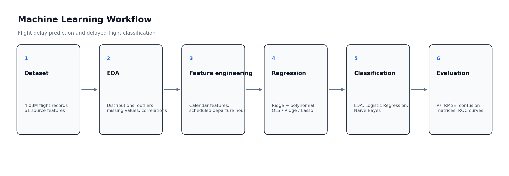

## Project goals

- Explore departure-delay behavior, missing values, outliers, and numeric relationships.
- Engineer calendar and scheduled-departure features from raw flight data.
- Predict departure delay in minutes using linear and regularized regression models.
- Examine whether polynomial feature expansion improves regression performance.
- Classify flights as **delayed** when departure delay exceeds 15 minutes.
- Compare LDA, Logistic Regression, and Naive Bayes using multiple evaluation metrics.

## Dataset

The analysis uses `Combined_Flights_2022.csv` from the Kaggle **Flight Delay Dataset (2018–2022)** collection. The analyzed 2022 file contains **4,078,318 flight records and 61 source features**. Variables include flight date, airline, origin, destination, scheduled and actual times, delays, elapsed time, distance, and related operational information.

The raw dataset is not stored in this repository because of its size. Dataset source: [Flight Delay Dataset (2018–2022) — Kaggle](https://www.kaggle.com/datasets/robikscube/flight-delay-dataset-20182022/data).

## Exploratory data analysis

Departure delays are strongly right-skewed, with a long tail of extreme delays. The boxplot also highlights the large number of high-delay outliers.

  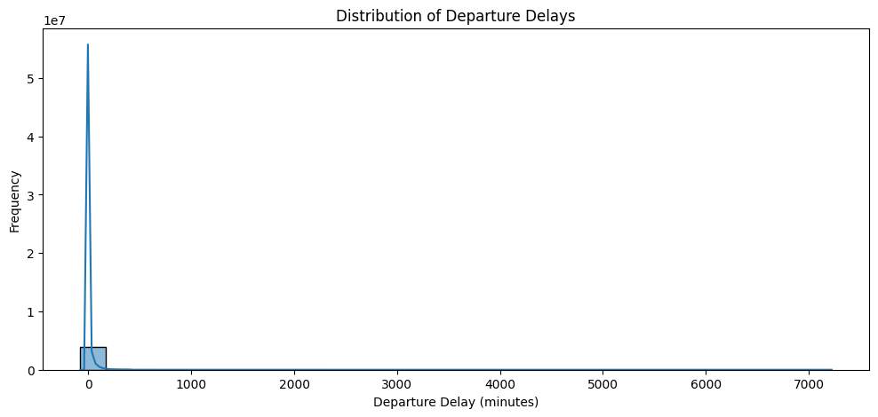
  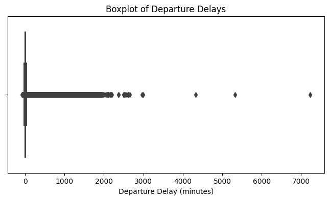

A numeric-feature correlation matrix was also used to inspect linear relationships across the available flight variables.

  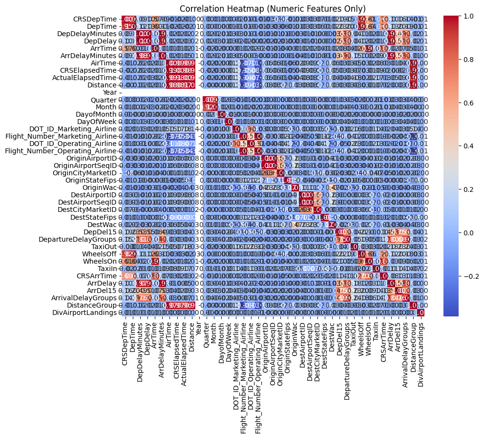

## Feature engineering

Three temporal features were derived before modeling:

- **Day of week** from the flight date
- **Month** from the flight date
- **Scheduled departure hour** from scheduled departure time

The modeling stage used schedule/calendar information together with elapsed time, distance, and airline information where applicable.

## Regression results

The primary regression model was Ridge regression. The best tested regularization setting was **alpha = 0.1**.

| Model | R² | RMSE (minutes) |
|---|---:|---:|
| Tuned Ridge | **0.017** | **53.041** |
| Polynomial OLS | 0.016 | 53.091 |
| Polynomial Ridge | 0.016 | 53.091 |
| Polynomial Lasso | 0.016 | 53.093 |

  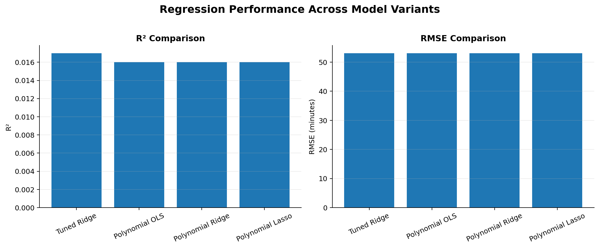

The predicted-versus-actual visualization shows that predicted values remain concentrated in a narrow range while actual delays extend much further. The residual distribution is correspondingly highly skewed.

  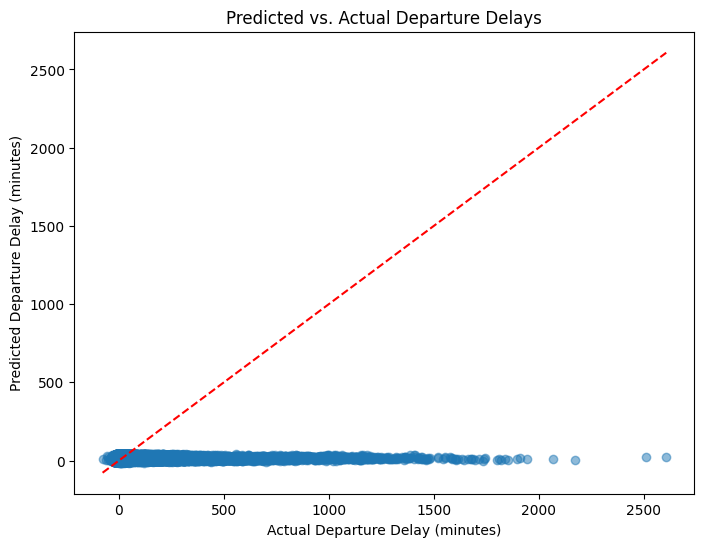
  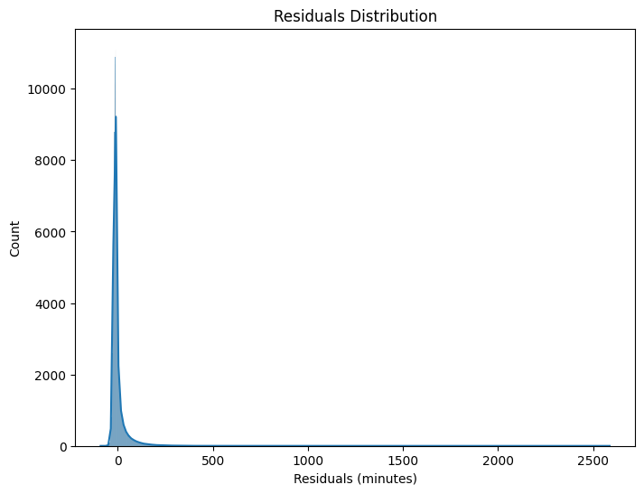

The low R² and approximately 53-minute RMSE indicate that the selected schedule and route features explain only a small fraction of departure-delay variability. Important external influences such as weather and air-traffic conditions are not represented in this feature set.

## Model complexity and regularization

Degree-2 polynomial features were used to investigate whether additional interactions could improve predictive performance. OLS, Ridge, and Lasso produced nearly identical results, showing that increased polynomial complexity did not provide a meaningful performance gain with the available features.

  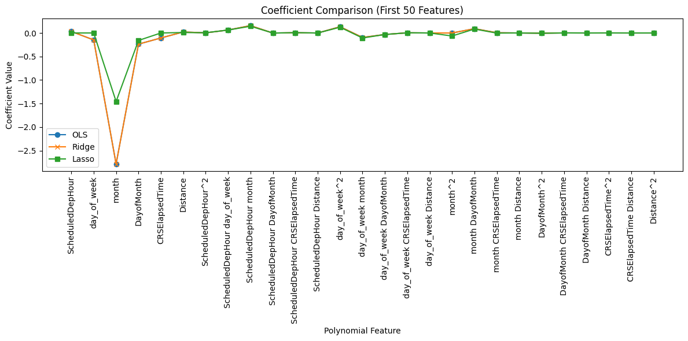

Lasso shrank several coefficients more aggressively toward zero, but the additional sparsity did not materially improve test performance.

## Classification results

A flight was treated as **delayed** when its departure delay exceeded **15 minutes**.

| Model | Accuracy | Precision | Recall | F1 |
|---|---:|---:|---:|---:|
| LDA | **0.795** | **0.502** | 0.018 | 0.035 |
| Logistic Regression | **0.795** | 0.498 | 0.010 | 0.020 |
| Naive Bayes | 0.687 | 0.313 | **0.442** | **0.367** |

  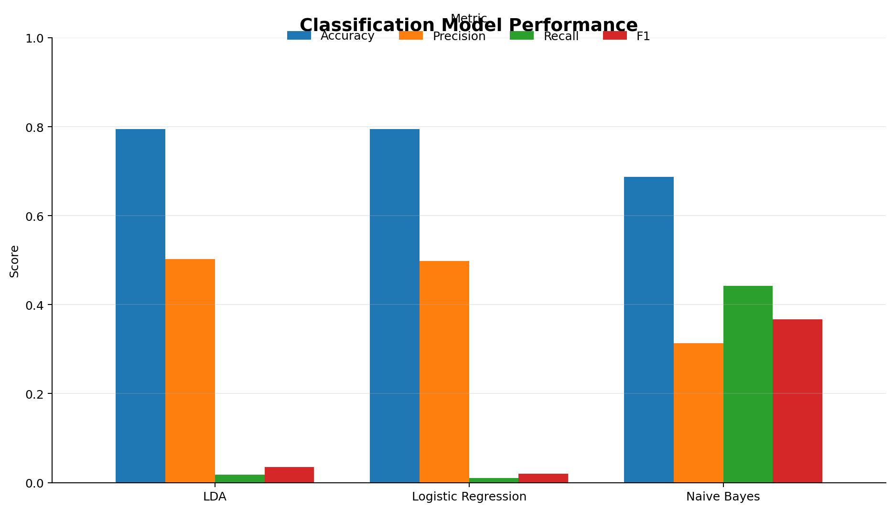

Accuracy alone is misleading in this case. LDA and Logistic Regression achieve the highest overall accuracy but recover very few delayed flights. Naive Bayes has lower accuracy while providing substantially higher recall and F1 for the delayed class.

  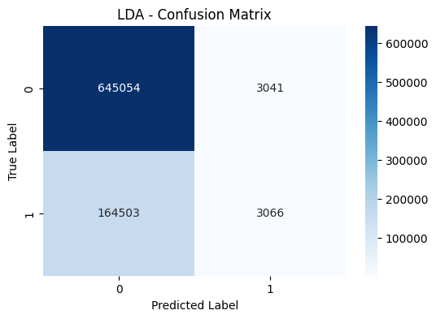
  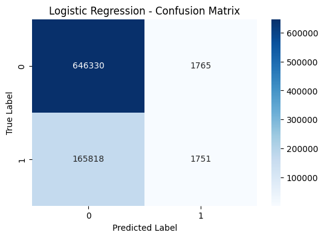
  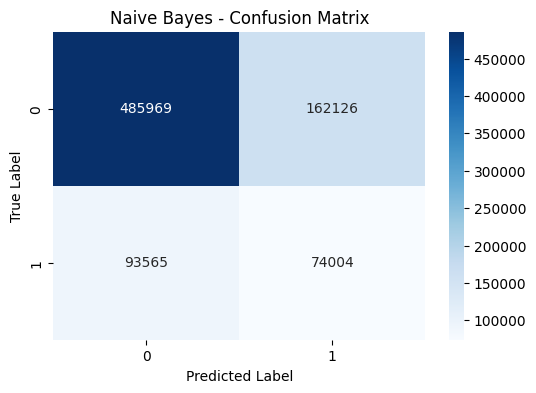

  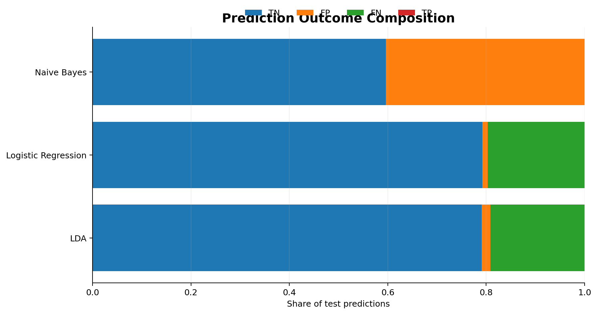

## ROC comparison

The ROC curves provide an additional comparison of the ranking behavior of all three classifiers.

  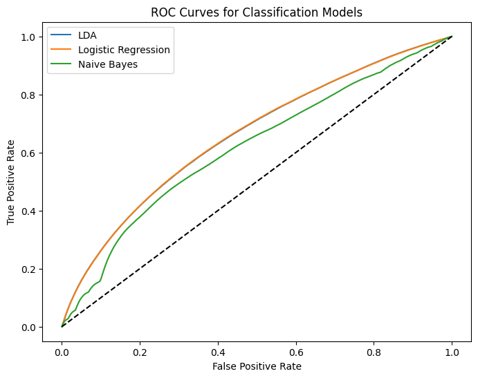

## Key findings

1. **Departure delays are highly skewed and contain extreme outliers**, making exact delay prediction challenging.
2. **The available schedule and route features provide weak regression signal**, with the best R² reaching only 0.017.
3. **Polynomial expansion and regularization do not materially improve regression performance**, suggesting that missing explanatory variables are a larger limitation than overfitting.
4. **Classification metrics reveal different trade-offs**: LDA and Logistic Regression maximize overall accuracy, while Naive Bayes detects many more delayed flights.
5. **Model choice depends on the objective**. When identifying delayed flights is more important than maximizing overall accuracy, recall and F1 become especially important.

## Limitations and future directions

The current feature set does not include important exogenous variables such as weather, airport congestion, air-traffic conditions, aircraft rotation, or network propagation effects. Future work could incorporate richer operational variables, class-imbalance strategies, tree-based models, calibrated probabilities, and time-aware validation.

## Project documentation

A concise technical summary of the analysis and findings is available in [`PROJECT_REPORT.md`](PROJECT_REPORT.md). Dataset notes are provided in [`DATASET.md`](DATASET.md).

## References

- [Flight Delay Dataset (2018–2022) — Kaggle](https://www.kaggle.com/datasets/robikscube/flight-delay-dataset-20182022/data)
- [scikit-learn documentation](https://scikit-learn.org/)
